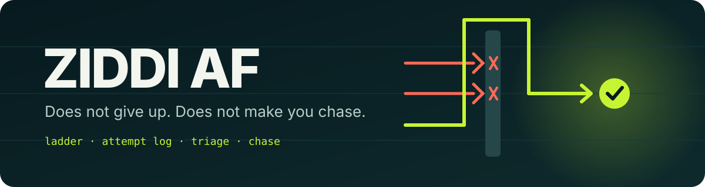
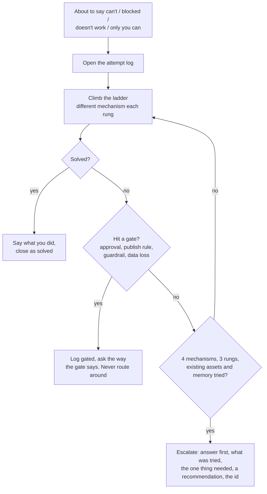
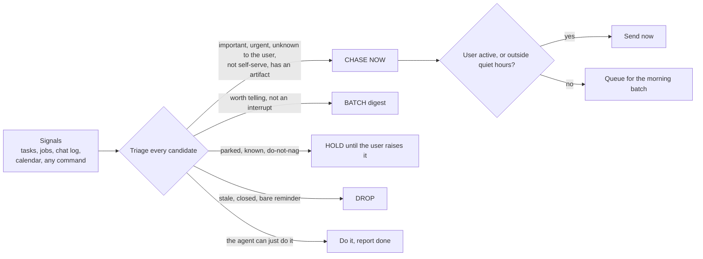

<p align="center">
  
</p>

<h1 align="center">Ziddi AF</h1>

<p align="center">
  <strong>A skill that makes your AI agent relentless inside a task, and proactive outside it.</strong><br>
  It tries ten ways before it says "can't", and it comes to you with the finished work before you have to ask.
</p>

<p align="center">
  <a href="LICENSE"></a>
  
  
  
  
</p>

<p align="center">
  <a href="#install">Install</a> ·
  <a href="#use">Use</a> ·
  <a href="#how-it-works">How it works</a> ·
  <a href="#the-attempt-log">Attempt log</a> ·
  <a href="#the-chase-engine">Chase engine</a> ·
  <a href="#a-run-you-can-reproduce">A run</a> ·
  <a href="#rules-that-never-bend">Rules</a> ·
  <a href="PORTABLE_PROMPT.md">Portable prompt</a>
</p>

---

## 30 seconds

**Inside a task** (the agent may not give up without showing its work):

```text
you    pull the order list from the shop admin

agent  I can't get the order list, only you can create a token.      <- the draft the agent was about to send

check  FLAG: give-up language and no attempt-log id (zid-YYYYMMDD-xxxx)

agent  (tries the CSV export, the credentials folder, past notes, the vendor docs, logs each one)
       Order list needs a service token, and only the shop owner can create one (2 minutes).
       Tried: admin API (401), CSV export (same 401), stored credentials (only the expired one),
       past notes (refresh needs a phone approval), vendor docs (owner-only).  zid-20260310-1a00
       I recommend: create it with read-only orders scope; I pull the list and schedule a weekly refresh.
```

**Outside a task** (the agent comes to you, once, with the work done):

```text
[ACTION] Harbor & Pine renewal quote
State: Quote is drafted; the discount percent is blank and the offer lapses tomorrow at 17:00.
Next: Send me the discount percent you will give (30 seconds)
Reply: the number, or 'hold'
```

No "just checking in", no daily repeat, nothing at 3 a.m. unless you are up. The same item is never said twice unless something changed.

## Why

Every agent user knows both failures. The agent says "I can't do that" after one try, and you find the way yourself in five minutes. Or the agent finishes something, says nothing, and you discover it three days later by asking "any update?".

On 30 days of one busy operator's real agent traffic, before this existed: **86% of the "can't / blocked / doesn't work" replies showed no sign of any attempt**, and in several of them the operator then supplied the missing route themselves (a different tool, a credential that already existed, the adjacent outcome). They chased the agent 25 times. Of 67 promises of later delivery, **53%** arrived without being asked for.

The inspiration was a product whose edge is that it is relentless: when something does not work it finds ten other ways, and when you do not reply it comes to you with what it found. This is that behaviour as a skill any agent can follow, with the guardrails kept intact.

Ziddi is Hindi for stubborn. Stubborn about the goal, never about the guardrails.

## Install

Works with any agent that reads `SKILL.md` style skill files: Claude Code, OpenClaw, Codex, Cursor, Windsurf, or anything with a skills directory.

```bash
git clone https://github.com/rushindrasinha/ziddi-af.git

# Claude Code (global)
cp -r ziddi-af/skill/ziddi-af ~/.claude/skills/ziddi-af

# OpenClaw or any workspace with a skills directory
cp -r ziddi-af/skill/ziddi-af <your-workspace>/skills/ziddi-af
```

Make it a rule for **every** agent and sub-agent, not just one that loads the skill: paste [`rules/AGENT_RULES.md`](rules/AGENT_RULES.md) into your `AGENTS.md` / `CLAUDE.md` / system prompt, and the ziddi clause from [`rules/SUBAGENT_PROMPT_STANDARD.md`](rules/SUBAGENT_PROMPT_STANDARD.md) into your sub-agent task prompts.

Optional: choose where state lives (attempt log, dedupe gate, queue).

```bash
export ZIDDI_HOME=~/.ziddi        # this is the default
cp ziddi-af/examples/ziddi.example.config.json ~/.ziddi/config.json   # then edit: timezone, quiet hours, your signal sources
```

> [!NOTE]
> Python 3.9+ and nothing else. No packages, no network calls unless you configure a webhook. Tested on 3.9 and 3.14: `python3 -m unittest discover -s tests`.

No agent with a skills directory? Paste [`PORTABLE_PROMPT.md`](PORTABLE_PROMPT.md) into any chat model and it will keep its own attempt log and triage in the conversation.

## Use

Say any of these, or let the situation trigger it (a draft reply that says "can't", a promise of later work, a finished job):

| Say | What happens |
|---|---|
| `ziddi` / `don't give up` / `find another way` | the agent restarts the ladder on the goal and logs each rung |
| `chase me` / `keep me posted` | the agent runs the chase engine and brings what is due |
| `resume where you left off` | picks up the open attempt log (`attempts.py open`) |

Commands (all from `skill/ziddi-af/scripts/`):

```bash
python3 attempts.py add --goal "..." --rung tool --did "..." --result fail --why "..." --cmd "..."
python3 attempts.py verdict zid-... --outcome exhausted --ask "the one thing needed" --recommend "what you suggest"
python3 ziddi_giveup_check.py --verify --text "draft reply to check"
python3 ziddi_chase.py --config ziddi.config.json --dry-run --md out.md
```

## How it works



The ladder: **fix the cause and retry, a different tool, a different route, what already exists in your setup, what your notes say worked before, the docs, the solvable sub-part, the adjacent outcome.** A different mechanism means a different tool or route, not the same command with new flags; the log counts `curl -A x` and `curl -L -H y` as one.



<details>
<summary><strong>The seven checks every chase must pass</strong></summary>

1. **It carries an artifact or a decision with a recommendation.** Never "just checking in".
2. **Triage with a reason.** CHASE NOW, BATCH, HOLD or DROP, and the reason is printed for every candidate.
3. **If the agent can just do it, it does it and reports done.** Reversible, in its own lane, no gate.
4. **New information only.** Same item, same content, same deadline tier: held, however long it has been. No daily cap; the novelty gate is the limiter. A deadline entering 48 h, 24 h or 1 h, or going 7 or 14 days overdue, counts as new.
5. **Bite-sized.** One next action with its time cost, one low-effort reply, about 60 words, smallest step first.
6. **Quiet hours** (default midnight to 6 a.m., your timezone), **unless you are active** (you did something on any surface in the last 30 minutes). Otherwise it queues for the morning batch.
7. **Escalation cadence.** 1st touch: the artifact. 2nd touch: only with new information, and it announces a pre-agreed reversible default. 3rd touch: never a louder repeat; the default is carried out and reported with how to undo it, or the item is parked. A gated item never gets a default. Silence is not consent.

</details>

## The attempt log

Append-only JSONL. One line per attempt, one line per verdict. A reply that gives up must cite an id whose verdict is `exhausted`, `gated` or `budget-stop`.

```bash
$ python3 attempts.py add --goal "Pull the order list" --rung tool --did "Call the admin API" \
      --result fail --why "401 with the stored token" --cmd "curl https://shop.example.invalid/api/orders"
zid-20260310-1a00

$ python3 attempts.py verdict zid-20260310-1a00 --outcome exhausted --ask "a fresh token" --recommend "create one"
cannot call this exhausted yet:
  - 1 distinct mechanisms, need 4
  - 1 rungs used, need 3
  - rung 'assets' never tried (existing scripts, MCP servers, credentials in your own setup)
  - rung 'memory' never tried (memory, notes and past transcripts for a prior working path)
Keep climbing the ladder.
```

`exhausted` needs 4 distinct mechanisms over 3 rungs, **including** what already exists in your setup and what your notes say worked before. `gated` names the guardrail and needs no ladder, because a gate is never routed around. `budget-stop` checks the clock (20 minutes by default). Everything is configurable. A full worked log is in [`examples/attempt_log_example.md`](examples/attempt_log_example.md).

### The give-up detector

`ziddi_giveup_check.py` is deterministic, stdlib, no model. It finds first-person give-ups ("I can't", "it doesn't work", "I'm blocked on", "only you can", "no way to") and ignores approvals, quoted logs, code blocks, negations, conditionals and failures narrated together with their fix. It runs standalone, as a Claude Code `Stop` hook (`--hook-stop`), or as a pre-send hook for a message tool (`--hook-pretool`). Hooks **observe** by default and only block with `--enforce`.

It is tuned for precision. On the bundled hand-written set it scores 92% precision and 77% recall; on 30 days of real agent output it measured about 80 to 90% precision and about 40% recall among messages containing hint words. Treat it as a backstop, and run it in observe mode for a week before you enforce anything.

## The chase engine

You tell it where your open items live; it tells you which ones deserve you, and why.

```json
{
  "timezone": "Europe/Berlin",
  "quiet_hours": {"start": "00:00", "end": "06:00"},
  "topics": {"money": {"invoice": 2, "renewal": 3}, "suppress": [{"keywords": ["newsletter"], "why": "stop nagging me"}]},
  "signals": [
    {"adapter": "items",        "path": "tasks.json"},
    {"adapter": "jobs",         "path": "jobs.json"},
    {"adapter": "conversation", "path": "chat.jsonl"},
    {"adapter": "ics",          "path": "calendar.ics"},
    {"adapter": "command",      "command": ["python3", "my_unread_mail_headers.py"]}
  ],
  "delivery": {"adapter": "webhook", "payload": "slack"}
}
```

Signal sources and delivery are adapters you wire yourself. `items`, `jobs`, `conversation` and `ics` read plain files; `command` runs any program that prints JSON (that is the bridge to a mail client, `gh`, a CRM, your own database); delivery is `stdout`, `file` or a `webhook` (Slack, Discord, or any gateway with an HTTP API; the URL lives in an environment variable). **Nothing ships pointing at an account, channel or path.** Details: [`signals.md`](skill/ziddi-af/references/signals.md), [`delivery.md`](skill/ziddi-af/references/delivery.md), [`triage.md`](skill/ziddi-af/references/triage.md), [`config.md`](skill/ziddi-af/references/config.md).

It is a **dry run** until you pass `--live`. A dry run sends nothing and writes nothing.

## A run you can reproduce

Everything below is invented (Harbor & Pine, Northwind, Lumen are fictional). From a fresh clone:

```bash
python3 skill/ziddi-af/scripts/ziddi_chase.py --config examples/ziddi.example.config.json \
        --dry-run --now "2026-03-10 05:10" --user-active-at "2026-03-10 04:50" --md out.md
```

```text
18 candidates: CHASE NOW 3, BATCH 6, HOLD 3, DROP 6.

CHASE NOW  Harbor & Pine renewal quote   importance 9, 36 h to the deadline, artifact ready, a NEW ask (discount percent)
CHASE NOW  Pick the dentist slot         importance 6, inside 24 h, recommendation ready
CHASE NOW  Unanswered message            the user wrote 3 h ago and nothing answered it: the chase IS the answer
BATCH      Northwind invoice question    the agent drafts the reply itself, reports "done, ready"
BATCH      Staging TLS certificate       the agent renews it itself, reports done
BATCH      Tax filing: last day to withdraw   important (8) but 7 days out and no memo yet: prepare the memo, re-triage at 48 h
HOLD       Sign the NDA from Lumen       parked waiting on the user for 59 days: never resurface without fresh evidence
HOLD       Newsletter cleanup            standing "stop nagging me" topic
DROP       Migrate the old wiki          last verified 128 days ago, no deadline: a verify-first task, not a chase
DROP       Cold pitch: boost your SEO    noise
```

The full output, with scores, "already told" evidence and the novelty-gate result for every one of the 18, is in [`examples/dry_run_example.md`](examples/dry_run_example.md). The three-touch cadence on one item is in [`examples/cadence_example.md`](examples/cadence_example.md). Regenerate both with `python3 examples/make_examples.py`; a test fails if they go stale.

## Rules that never bend

> [!IMPORTANT]
> **Stubborn about the goal, never about the guardrails.** An approval you do not hold, a publish or send rule, a production guardrail, a data-loss step, credentials that are not yours, spending without standing authority, an action you were told not to take: these are not obstacles. The agent names the gate, logs it as `gated`, and asks.

> [!WARNING]
> **Silence is never consent.** A reply you did not send is not a yes. A default may be carried out only if it is reversible and was agreed in advance, and never for an item that is waiting on your approval.

- A chase without an artifact or a recommended decision does not go out. The agent prepares first.
- Same content, same deadline tier: never said twice.
- Nothing is sent from a dry run. `--live` and a delivery adapter are both opt-in.
- Bodies of private messages are never needed to triage; adapters can work from headers and metadata only.

## Files

| Path | Purpose |
|---|---|
| [`skill/ziddi-af/SKILL.md`](skill/ziddi-af/SKILL.md) | The procedure the agent follows |
| [`skill/ziddi-af/scripts/`](skill/ziddi-af/scripts/) | `attempts.py`, `ziddi_giveup_check.py`, `ziddi_chase.py` and the stdlib library behind them |
| [`skill/ziddi-af/references/`](skill/ziddi-af/references/) | Signals, delivery, triage table, message style, config keys, the detector's test set |
| [`rules/`](rules/) | The all-agents rule block and the sub-agent prompt standard, copy-paste |
| [`PORTABLE_PROMPT.md`](PORTABLE_PROMPT.md) | The whole behaviour as one prompt for any chat model |
| [`examples/`](examples/) | A fictional dry run, a fictional attempt log, the cadence, example signals and config |
| [`tests/`](tests/) | 30 stdlib tests: detector, attempt log, triage, dedupe gate, quiet hours, cadence, CLI |

## FAQ

<details>
<summary><strong>Won't an always-chasing agent be a nag?</strong></summary>
That is the failure this is built to avoid. Most candidates are not interrupts: in the bundled example 3 of 18 are, and each carries finished work and one small ask. Everything else is a digest line, a done-receipt, parked, or dropped, with the reason printed. An unchanged item never repeats.
</details>

<details>
<summary><strong>Can the agent still say "I can't"?</strong></summary>
Yes, after it has actually tried: four different mechanisms over three rungs, including what already exists in your setup and what your notes say worked before. Then it says what it tried, the one thing it needs from you, and what it recommends. A guardrail needs no ladder; it just gets named.
</details>

<details>
<summary><strong>Does it work without an agent framework?</strong></summary>
Yes. <code>PORTABLE_PROMPT.md</code> carries the behaviour for any chat model. With a framework, the scripts add the enforced attempt log, the detector and the engine.
</details>

<details>
<summary><strong>Where does state live, and can I delete it?</strong></summary>
<code>~/.ziddi</code> (or <code>$ZIDDI_HOME</code>): attempt log, dedupe gate, queue, sent log. Plain JSON and JSONL, so <code>grep</code>, <code>jq</code> and git all work. Delete the folder to reset everything.
</details>

<details>
<summary><strong>Will it read my email?</strong></summary>
Only if you wire a command that does, and the intended pattern is headers and metadata only: the triage needs a sender, a subject and a date, not a body.
</details>

## Contributing

Issues and pull requests welcome. Keep the spine (ladder with a log, stop rule, triage with reasons, novelty gate, quiet hours) intact; add signal or delivery adapters behind it. Every change to the procedure needs a real run in the PR description, and `python3 -m unittest discover -s tests` green.

## License

MIT. Do what you want, keep the notice.

<p align="center">
  <sub>Built by <a href="https://github.com/rushindrasinha">rushindrasinha</a>. v1.0.0, 2026-10-13.</sub>
</p>
